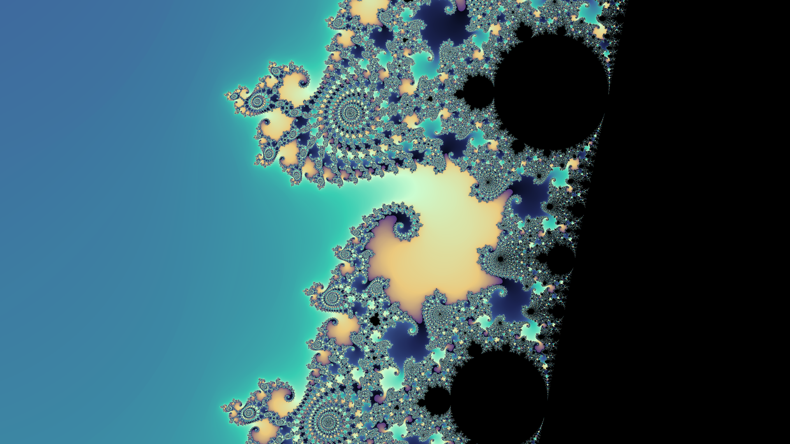
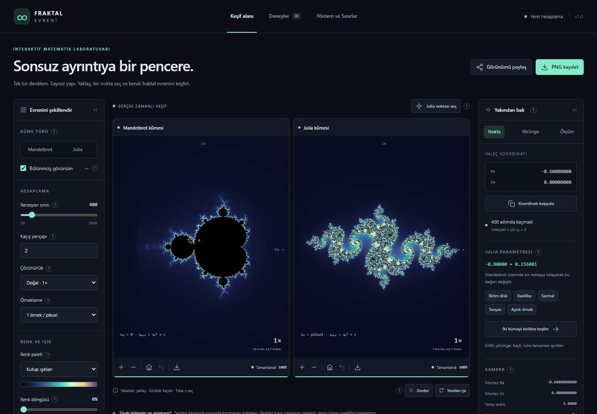
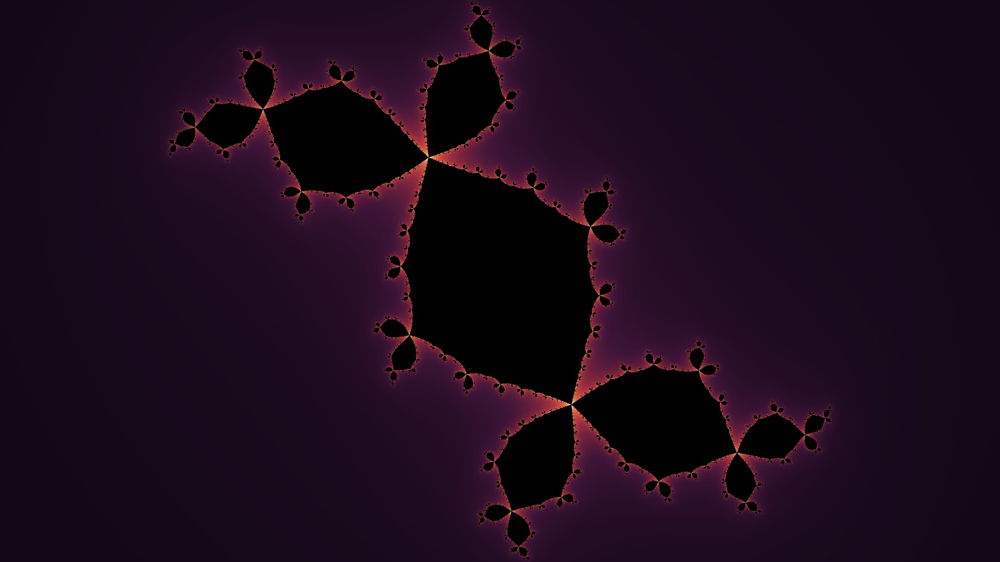

# Sonsuz Fraktal Evreni

Mandelbrot ve Julia kümelerini tarayıcıda keşfetmek için Türkçe, etkileşimli bir matematik laboratuvarı. Görüntüler hazır resim değildir: her piksel `zₙ₊₁ = zₙ² + c` iterasyonuyla cihazında hesaplanır. Hesap açma, API anahtarı ve sunucu tarafı işlem gerekmez.



## Özellikler

- **Serbest keşif:** tekerlek, sürükleme, iki parmakla yakınlaştırma ve klavye kısayolları. Her küme için ayrı kamera geçmişi.
- **Bölünmüş görünüm:** Mandelbrot üzerinde bir nokta seç, ona karşılık gelen Julia kümesini yanında canlı izle.
- **Görsel kaydetme:** görünümü ekrandaki boyutta, Full HD veya 4K PNG olarak indir.
- **Renk ve kalite ayarları:** beş palet, renk döngüsü, parlaklık, çözünürlük, kenar yumuşatma ve 3000'e kadar iterasyon.
- **Sekiz yönlendirmeli deney:** iterasyon sınırı, kritik yörünge, bağlılık gibi konuları kendin dene.
- **Yörünge paneli:** bir başlangıç noktasının adım adım yolunu çiz, iki yakın başlangıcı karşılaştır, CSV indir.
- **Ölçüm paneli:** aynı kamerada altı gerçek çizimin süresini karşılaştır.
- **Paylaşım ve kayıt:** görünümü URL ile paylaş, ayarları JSON olarak dışa ve içe aktar.
- **Bağlam içi yardım:** özelliklerin yanındaki **?** düğmesi kısa bir açıklama açar.





## Kurulum

Node.js **22.12 veya üzeri** gerekir.

```sh
pnpm install --frozen-lockfile
pnpm run dev
```

Uygulama **http://127.0.0.1:5191** adresinde açılır. `pnpm` yoksa `npm install` ve `npm run dev` de çalışır.

| Komut | Ne yapar |
|---|---|
| `pnpm test` | Matematik ve arayüz testlerini çalıştırır |
| `pnpm run build` | TypeScript kontrolü yapar ve `dist` klasörünü üretir |
| `pnpm start` | Derlenmiş `dist` klasörünü Node.js ile sunar (`PORT` ile port değişir) |
| `pnpm run test:browser` | Çalışan sunucuda gerçek tarayıcı testlerini çalıştırır |

Derleme sonrası Windows'ta `BASLAT.cmd` dosyasına çift tıklamak sunucuyu başlatır ve tarayıcıyı açar. `index.html` dosyasını doğrudan açmak modül ve worker kısıtları nedeniyle çalışmaz.

Tarayıcı testleri Windows'ta kurulu Chrome'u kullanır. Başka bir ortamda `npx playwright install chromium` çalıştır veya `BROWSER_PATH` ile bir Chromium yolu ver. `TEST_URL` test edilecek adresi değiştirir.

## Kısayollar

| Girdi | Etki |
|---|---|
| Tekerlek / iki parmak | İmleçte yakınlaştır |
| Sürükleme / ok tuşları | Kaydır |
| `+` / `−` | Yakınlaştır, uzaklaştır |
| `H` | Ana görünüm |
| `B` | Önceki görünüm |
| Mandelbrot'a tıklama | Julia parametresi c'yi seç |

Klavye kısayolları tuval odaktayken çalışır; tuvale Tab ile odaklanılabilir.

## Nasıl çalışır

Mandelbrot için `z₀ = 0` ve `c = piksel`, Julia için `z₀ = piksel` ve `c` seçili parametredir. `|z|`, kaçış yarıçapını geçtiğinde nokta kaçmış sayılır ve kaçış süresi renge çevrilir. Keyfi `c` değerleri için `(1 + √(1 + 4|c|)) / 2` alt sınırı otomatik uygulanır.

Hesap Web Worker'da çift hassasiyetli sayılarla yapılır, görüntü Canvas 2D'ye çizilir. Önce küçük bir önizleme, ardından tam çözünürlük hesaplanır; yeni bir hareket eski işi iptal eder. Full HD ve 4K görseller birden çok işçiye bölünerek ve piksel başına dört örnekle üretilir.

```text
src/core/        kompleks aritmetik, kaçış testi, kamera, palet, oturum
src/engine/      satır hesabı, worker, yüksek çözünürlüklü dışa aktarma
src/components/  tuval, yörünge ve ölçüm panelleri, yardım düğmesi
src/data/        deneyler ve açıklama metinleri
src/App.tsx      oturum, ayarlar ve sayfalar
tests/           birim ve arayüz testleri
scripts/         yerel sunucu ve gerçek tarayıcı testleri
```

## Sınırlar

- **Sonsuz zoom yoktur.** Hesap 64 bit sayılarla yapılır; yakınlaştırma yaklaşık 10¹² katta durur ve görüntü bu sınıra yaklaşırken pikselleşir. Uygulama sınıra yaklaşınca uyarı gösterir. Perturbasyon veya keyfi hassasiyet modu yoktur.
- **Siyah piksel küme üyeliğini kanıtlamaz.** Yalnızca seçilen adım sayısında kaçmadığını gösterir. Renkler de matematiksel kümenin parçası değil, kaçış süresinin görsel eşlemesidir.
- **Hesap işlemcide yapılır.** GPU kullanılmaz; yüksek iterasyon ve 4K seçenekleri zaman alabilir. Normal gezinmede görünüm başına bir işçi çalışır.
- **Tarayıcı gereksinimi:** modül worker destekleyen güncel bir tarayıcı gerekir.

## Kaynak

[Cornell Math Explorers' Club: The Mandelbrot Set](https://pi.math.cornell.edu/~lipa/mec/lesson5.html)
